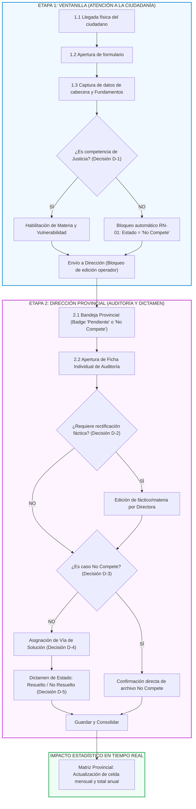
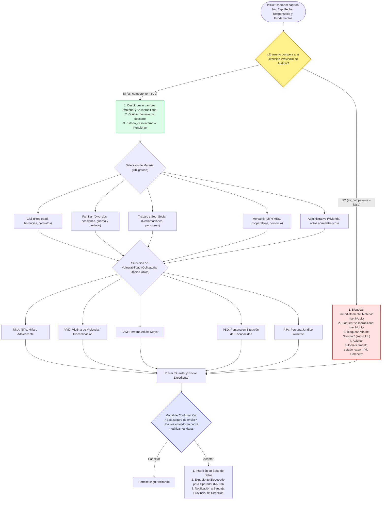
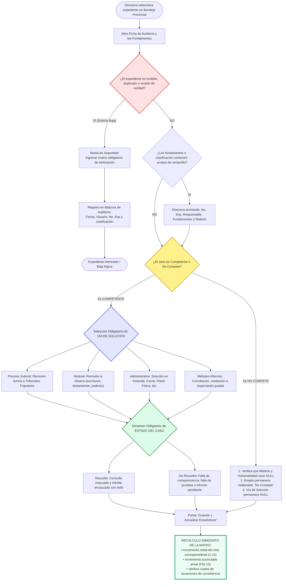

# ESPECIFICACIÓN INTEGRAL DE FLUJO DE EXPEDIENTE Y ÁRBOLES DE DECISIÓN
## SISTEMA DE ASESORÍA JURÍDICA Y ESTADÍSTICA PROVINCIAL ("WEB ESTADÍSTICA JUSTICIA")
**Cliente:** Dirección Provincial de Justicia de Camagüey  
**Tipo de Documento:** Guía Operativa, Modelo de Campos y Lógica de Decisión Paso a Paso  
**Versión:** 1.0  
**Fecha:** Marzo de 2026  

---

## 1. INTRODUCCIÓN Y VISIÓN PANORÁMICA

Este documento describe con granularidad técnica y funcional el ciclo de vida completo de un expediente dentro del sistema **"Web Estadística Justicia"**, desde el momento en que un ciudadano comparece ante la ventanilla de **Atención a la Ciudadanía** hasta que el caso es auditado, dictaminado y cerrado por la **Directora Provincial de Justicia**, impactando de forma matemática e inmediata en la **Matriz Estadística Provincial**.



---

## 2. ETAPA 1: ATENCIÓN A LA CIUDADANÍA (VENTANILLA)

### 2.1. Descripción Operativa
El ciudadano comparece físicamente en la sede provincial. El operador de ventanilla accede al sistema con su usuario y contraseña (rol `Atención`) y pulsa en **"Nuevo Expediente"**.

---

### 2.2. Catálogo Detallado de Campos en Etapa 1

| Campo | Control de Interfaz (UI) | Tipo / Longitud | Obligatorio | Valor por Defecto / Ayuda (*Placeholder*) | Comportamiento y Validación |
| :--- | :--- | :--- | :---: | :--- | :--- |
| **`no_expediente`** | Caja de texto (`<input type="text">`) | Alfanumérico (VarChar 50) | **SÍ** | `"EXP-2026-0001"` *(o manual)* | Clave única. El sistema valida en tiempo real que no exista duplicidad en la base de datos provincial. |
| **`fecha_atencion`** | Selector de fecha (`<input type="date">`) | Date (YYYY-MM-DD) | **SÍ** | Fecha actual del servidor | Bloquea fechas futuras. Permite retroceder si se regularizan casos del día anterior. |
| **`responsable`** | Caja de texto (`<input type="text">`) | VarChar(150) | **SÍ** | `"Nombre y apellidos del asesor"` | Nombre del funcionario que atiende al ciudadano. |
| **`es_competente`** | Selector de Radio Button doble | Booleano (`true` / `false`) | **SÍ** | *(Sin selección previa obligatoria)* | **Interruptor maestro del árbol de decisión.** Dispara la lógica condicional en la interfaz. |
| **`fundamentos`** | Área de texto enriquecido / multilinea (`<textarea rows="6">`) | Text (hasta 4000 caracteres) | **SÍ** | *"Describa detalladamente: Nombre y apellidos del solicitante, Carnet de Identidad, dirección/municipio, teléfono de contacto y resumen fáctico de la consulta..."* | **Campo exhaustivo de identificación.** Al no existir campos atómicos separados para los datos personales, concentra la información civil y los hechos del conflicto (Regla RN-02). |
| **`materia`** | Menú desplegable (`<select>`) | Enum (5 opciones) | **Condicional** | *"Seleccione la rama jurídica..."* | **Habilitado solo si `es_competente = true`.** Si es falso, permanece deshabilitado (`disabled`) con valor `NULL`. |
| **`vulnerabilidad`** | Grupo de 5 Radio Buttons | Enum (5 siglas) | **Condicional** | *(Ninguno marcado)* | **Habilitado solo si `es_competente = true`.** Opción única obligatoria si compete. |
| **`via_solucion`** | Caja informativa bloqueada con candado | Enum | **NO (Para Ventanilla)** | `[ Pendiente de dictamen por Dirección ]` | **Solo lectura / bloqueado.** El operador no puede modificar ni seleccionar este valor. |
| **`estado_caso`** | Caja informativa bloqueada con candado | Enum | **NO (Para Ventanilla)** | `[ Pendiente de dictamen por Dirección ]` *(o "No Compete" automático)* | Si `es_competente = false`, muestra automáticamente `"No Compete"`. Si es verdadero, muestra `"Pendiente de Auditoría"`. |

---

### 2.3. Árbol de Decisión 1 (AD-1): En Ventanilla



---

## 3. ETAPA INTERMEDIA: TRANSFERENCIA Y BLOQUEO DE INTEGRIDAD (RN-03)

1. **Inmutabilidad para Ventanilla:** En cuanto el operador confirma el envío, el registro pasa a estado protegido.
2. **Acceso de Ventanilla en *"Mis Expedientes"*:**
   - La pantalla muestra una tabla de consulta histórica de los casos creados por dicho operador.
   - Solo dispone del botón **`Ver Ficha`** en modalidad estrictamente de solo lectura.
   - No existen botones de *"Editar"*, *"Actualizar"* ni *"Borrar"*.
   - Cualquier error detectado con posterioridad por el operador debe ser comunicado formalmente a la Directora para su enmienda institucional.

---

## 4. ETAPA 2: DIRECCIÓN PROVINCIAL (AUDITORÍA, DICTAMEN Y CIERRE)

### 4.1. Descripción Operativa
La **Directora Provincial de Justicia** accede al sistema con sus credenciales de máxima jerarquía funcional (rol `Dirección`). La plataforma la sitúa en la **Bandeja Provincial de Expedientes**, donde confluyen todas las atenciones registradas en la provincia.

---

### 4.2. Vista 1 de Dirección: Bandeja Provincial de Expedientes

La bandeja presenta el listado general con herramientas de ordenación cronológica y semáforo visual:

| Elemento UI | Descripción / Función |
| :--- | :--- |
| **Tabla Provincial** | Columnas: `No. Expediente`, `Fecha`, `Responsable`, `Competente`, `Materia`, `Vulnerabilidad`, `Estado`, `Acciones`. |
| **Badges de Estado** | • **Amarillo (`Pendiente`):** Caso competente enviado por ventanilla que aún no ha sido dictaminado por la Directora.<br>• **Gris (`No Compete`):** Caso descartado por falta de jurisdicción institucional.<br>• **Verde (`Resuelto`):** Caso concluido satisfactoriamente con orientación agotada.<br>• **Naranja (`No Resuelto`):** Caso concluido por incomparecencia o falta de elementos. |
| **Filtro Rápido** | Permite filtrar por: *Todos los casos*, *Pendientes de dictamen*, *Casos resueltos*, *No compete*. |
| **Botón de Acción por Fila** | **`Auditar y Dictaminar`**: Abre el modal / pantalla de auditoría individual del caso. |

---

### 4.3. Vista 2 de Dirección: Ficha de Auditoría y Dictamen Legal

Al ingresar a la ficha del caso, la Directora tiene a su disposición todos los campos del expediente con facultades plenas de rectificación y dictamen:

| Sección en Ficha | Campos Disponibles | Permisos de Dirección | Reglas de Interacción |
| :--- | :--- | :---: | :--- |
| **Cabecera** | `no_expediente`, `fecha_atencion`, `responsable` | Edición plena | Permite rectificar errores en la numeración o el nombre del asesor. |
| **Fáctico** | `fundamentos` | Edición plena | Permite enriquecer, clarificar o corregir la redacción fáctica de ventanilla. |
| **Competencia** | `es_competente` | Edición plena | Si la Directora rectifica de "No Compete" a "Competente" (o viceversa), el sistema reajusta la visibilidad de los catálogos. |
| **Clasificación** | `materia`, `vulnerabilidad` | Edición plena | Permite rectificar la rama jurídica si el operador la tipificó erróneamente. |
| **Dictamen: Vía de Solución** | `via_solucion` | **Exclusivo de Dirección** | Menú desplegable con 4 opciones institucionales. Obligatorio si el caso es competente. |
| **Dictamen: Estado del Caso** | `estado_caso` | **Exclusivo de Dirección** | Selector entre `Resuelto` y `No Resuelto`. (Si es "No Compete", se fija automáticamente). |
| **Botón Crítico de Baja** | `Eliminar Expediente` | **Exclusivo de Dirección** | Abre modal de confirmación exigiendo **Motivo obligatorio** y dejando rastro en la bitácora técnica. |
| **Botón de Cierre** | `Guardar y Actualizar Estadísticas` | **Exclusivo de Dirección** | Cierra el ciclo del expediente e impacta en la Matriz. |

---

### 4.4. Árbol de Decisión 2 (AD-2): En la Ficha de Dirección



---

## 5. IMPACTO EXACTO EN LA MATRIZ ESTADÍSTICA (MAPEO DE CELDAS)

Cuando la Directora confirma el dictamen, el caso impacta exclusivamente en la fila del **Mes de Atención** (`fecha_atencion`) y en la fila final **TOTAL ACUMULADO**, de acuerdo con las siguientes reglas:

```
┌────────────────────────────────────────────────────────────────────────────────────────────────────────────────┐
│ CASO TIPO A: "NO COMPETE"                                                                                      │
├────────────────────────────────────────────────────────────────────────────────────────────────────────────────┤
│  [+] Suma +1 en Bloque 1: 'Total Casos Atendidos' (Col 1)                                                      │
│  [=] NO suma en Bloque 1: 'Total Casos Competentes' (Col 2 queda intacta)                                      │
│  [=] NO suma en Bloque 2: 'Materias' (Cols 3 a 7 quedan intactas)                                              │
│  [=] NO suma en Bloque 3: 'Vulnerabilidades' (Cols 8 a 12 quedan intactas)                                    │
│  [+] Suma +1 en Bloque 4: 'No Compete' (Col 15)                                                                │
│  [=] NO suma en Bloque 5: 'Vías de Solución' (Cols 16 a 19 quedan intactas)                                     │
└────────────────────────────────────────────────────────────────────────────────────────────────────────────────┘

┌────────────────────────────────────────────────────────────────────────────────────────────────────────────────┐
│ CASO TIPO B: "COMPETENTE" (Ejemplo: Familiar, Adulto Mayor [PAM], Notarial, Resuelto)                         │
├────────────────────────────────────────────────────────────────────────────────────────────────────────────────┤
│  [+] Suma +1 en Bloque 1: 'Total Casos Atendidos' (Col 1)                                                      │
│  [+] Suma +1 en Bloque 1: 'Total Casos Competentes' (Col 2)                                                    │
│  [+] Suma +1 en Bloque 2: Materia correspondiente ('Familiar', Col 4)                                          │
│  [+] Suma +1 en Bloque 3: Vulnerabilidad correspondiente ('PAM', Col 10)                                      │
│  [+] Suma +1 en Bloque 4: Estado correspondiente ('Resueltos', Col 13)                                         │
│  [+] Suma +1 en Bloque 5: Vía de Solución dictaminada ('Notarial', Col 17)                                      │
└────────────────────────────────────────────────────────────────────────────────────────────────────────────────┘
```

---

## 6. SÍNTESIS COMPARATIVA DE CAMPOS POR ROL

| Campo | Rol: Personal de Atención | Rol: Directora Provincial | Rol: Administrador Técnico |
| :--- | :---: | :---: | :---: |
| `no_expediente` | Escritura inicial | Lectura y Rectificación | Sin acceso |
| `fecha_atencion` | Escritura inicial | Lectura y Rectificación | Sin acceso |
| `responsable` | Escritura inicial | Lectura y Rectificación | Sin acceso |
| `es_competente` | Selección inicial | Lectura y Rectificación | Sin acceso |
| `fundamentos` | Redacción inicial | Lectura y Rectificación | Sin acceso |
| `materia` | Selección inicial (si compete) | Lectura y Rectificación | Sin acceso |
| `vulnerabilidad` | Selección inicial (si compete) | Lectura y Rectificación | Sin acceso |
| `via_solucion` | **Bloqueado (Solo lectura)** | **Dictamen Obligatorio** | Sin acceso |
| `estado_caso` | **Bloqueado (Solo lectura)** | **Dictamen Obligatorio** | Sin acceso |
| `Eliminar registro` | **Prohibido** | **Permitido con justificación** | Sin acceso |
| `Matriz Estadística` | **Sin acceso** | **Acceso y explotación plena** | Sin acceso |
