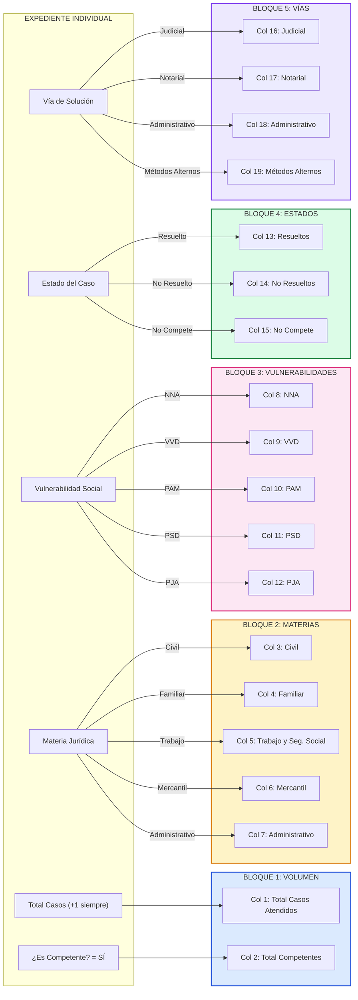

# CONFORMACIÓN DEL EXPEDIENTE Y TAXONOMÍA DE CATEGORÍAS
## GUÍA EXHAUSTIVA DE CAMPOS, MATERIAS, VULNERABILIDADES Y DICTAMEN
**Sistema:** "Web Estadística Justicia"  
**Entidad:** Dirección Provincial de Justicia de Camagüey  
**Clasificación:** Manual Técnico-Doctrinal de Clasificación y Reglas de Negocio  
**Versión:** 1.0  
**Fecha:** Marzo de 2026  

---

## 1. CÓMO SE CONFORMA EL EXPEDIENTE PASO A PASO

Un expediente no se crea completo en un solo acto, sino que se **construye progresivamente en capas acumulativas** según avanza en el circuito institucional. Cada capa incorpora metadatos, clasificaciones y decisiones jurídicas hasta consolidar el registro definitivo:

```
CAPA 1: CABECERA Y COMPARECENCIA (Ventanilla)
  └─ [No. Expediente] + [Fecha de Atención] + [Funcionario Asesor]

CAPA 2: FUNDAMENTOS FÁCTICOS Y CONTACTO (Ventanilla - Regla RN-02)
  └─ [Datos del Ciudadano: Nombre, CI, Dirección, Teléfono] + [Relato de la Situación Jurídica]

CAPA 3: FILTRO MAESTRO DE JURISDICCIÓN (Ventanilla - Regla RN-01)
  └─ [¿Es Competente?] ──┬── SÍ ──► Pasa a Capa 4 (Clasificación Socio-Jurídica)
                         └── NO ──► Bloqueo automático en cascada: Estado = 'No Compete'

CAPA 4: CLASIFICACIÓN SOCIO-JURÍDICA (Ventanilla - Obligatoria si Compete)
  ├─ [Materia Jurídica]: Civil | Familiar | Laboral | Mercantil | Administrativo
  └─ [Vulnerabilidad Social]: NNA | VVD | PAM | PSD | PJA

══════════════════ [ BARRERA DE INMUTABILIDAD - REGLA RN-03 ] ══════════════════
(El expediente se envía y se congela para el operador de ventanilla)

CAPA 5: AUDITORÍA Y CONTROL TÉCNICO (Dirección Provincial)
  └─ Lectura fáctica, rectificación de erratas materiales o baja lógica justificada

CAPA 6: DICTAMEN INSTITUCIONAL DE SOLUCIÓN (Dirección Provincial - Exclusivo)
  └─ [Vía de Solución]: Proceso Judicial | Notarial | Administrativo | Métodos Alternos

CAPA 7: CALIFICACIÓN DEL ESTADO FINAL (Dirección Provincial - Exclusivo)
  └─ [Estado del Caso]: Resuelto | No Resuelto  (o 'No Compete' automático)

CAPA 8: IMPACTO Y AGREGACIÓN EN MATRIZ ESTADÍSTICA (Motor Automático)
  └─ Suma exacta en celdas del mes y acumulación anual (13 filas x 20 columnas)
```

---

## 2. DESGLOSE EXHAUSTIVO DE LAS 5 MATERIAS JURÍDICAS

Cuando el caso se declara **Competente**, el operador debe encuadrar el conflicto en una de las cinco ramas del derecho previstas. Cada valor representa un ámbito sustantivo diferenciado y alimenta directamente las columnas 3 a 7 de la Matriz Estadística:

### 2.1. Materia Civil (Columna 3 de la Matriz)
* **Definición Doctrinal:** Rama que regula las relaciones jurídicas patrimoniales y personales no societarias entre ciudadanos o entre estos y entidades civiles.
* **Supuestos Típicos en Camagüey:**
  1. *Derechos Reales y Propiedad:* Disputas de linderos en fincas urbanas o suburbanas, ocupación indebida de inmuebles, posesión de bienes muebles.
  2. *Sucesiones y Herencias:* Asesoría sobre declaratoria de herederos, adjudicación de bienes hereditarios, impugnación de testamentos, cesión de cuotas hereditarias.
  3. *Obligaciones y Contratos:* Incumplimientos de permutas civiles, donaciones, préstamos dinerarios no bancarios, contratos de compraventa de vehículos y viviendas.
  4. *Estado Civil e Incapacidad:* Procesos de declaración de ausencia, presunción de muerte para trámites patrimoniales.
* **Criterio de Exclusión:** Si el conflicto sobre un inmueble proviene de una resolución de una Dirección Municipal de la Vivienda, **no es Civil**, sino **Administrativo**.

---

### 2.2. Materia Familiar (Columna 4 de la Matriz)
* **Definición Doctrinal:** Relaciones personales y patrimoniales derivadas del matrimonio, uniones de hecho afectivas, parentesco, filiación y figuras de protección en el marco del **Código de las Familias** (Ley 156/2022).
* **Supuestos Típicos en Camagüey:**
  1. *Filiación y Parentalidad:* Reconocimiento e impugnación de paternidad/maternidad, adopciones.
  2. *Relaciones Paterno-Filiales:* Responsabilidad parental, régimen de guarda y cuidado, régimen de comunicación familiar entre abuelos/tíos y menores.
  3. *Alimentos:* Reclamación de pensión alimenticia a favor de hijos menores o adultos mayores en situación de desamparo.
  4. *Disolución Vincular:* Divorcio contencioso o por mutuo acuerdo, liquidación de la comunidad matrimonial de bienes.
  5. *Uniones de Hecho:* Acreditación y liquidación del régimen económico de uniones de hecho afectivas.
* **Criterio de Ponderación:** Es la materia que con mayor frecuencia se combina con la condición de vulnerabilidad `NNA` (menores) o `VVD` (violencia).

---

### 2.3. Materia de Trabajo y Seguridad Social (Columna 5 de la Matriz)
* **Definición Doctrinal:** Tutela de los derechos de los trabajadores, régimen salarial, disciplina laboral y protección dispensada por el sistema de seguridad social y asistencia social (Ley 105/2008 y Código de Trabajo).
* **Supuestos Típicos en Camagüey:**
  1. *Reclamaciones Laborales:* Despidos disciplinarios injustificados, traslados forzosos, sanciones de amonestación, retención o rebaja de salarios.
  2. *Pensiones por Jubilación:* Acreditación de años de servicio ante el INASS, discrepancias en el cálculo de la cuantía de pensión por edad o jubilación anticipada.
  3. *Invalidez y Peritaje Médico:* Pensiones por invalidez total o parcial derivadas de accidentes de trabajo o enfermedades profesionales (COMAEP).
  4. *Seguridad Social Especial:* Subsidios de maternidad de madres trabajadoras (sector estatal o privado / MIPYMES).
  5. *Asistencia Social:* Orientación a personas sin amparo filial para tramitar subsidios de vulnerabilidad socioeconómica.

---

### 2.4. Materia Mercantil (Columna 6 de la Matriz)
* **Definición Doctrinal:** Actos de comercio, regulación de los nuevos actores económicos, sociedades comerciales, cooperativas no agropecuarias y contratación económica.
* **Supuestos Típicos en Camagüey:**
  1. *MIPYMES y Cooperativas:* Asesoría a socios de MIPYMES y CNA en Camagüey sobre reformas estatutarias, cesión de participaciones sociales, disolución y liquidación.
  2. *Contratos Comerciales:* Conflictos entre entidades estatales y nuevos actores económicos sobre contratos de compraventa, suministros, arrendamiento comercial o prestación de servicios.
  3. *Cobro de Deudas Comerciales:* Reclamaciones por facturas impagadas entre empresas.
  4. *Propiedad Industrial:* Dudas sobre registro de marcas y nombres comerciales ante la OCPI.

---

### 2.5. Materia Administrativa (Columna 7 de la Matriz)
* **Definición Doctrinal:** Relación entre el ciudadano y los órganos de la administración del Estado, impugnación de actos administrativos unilaterales y trámites regulatorios oficiales.
* **Supuestos Típicos en Camagüey:**
  1. *Trámites de la Vivienda:* Inconformidades con resoluciones de las Direcciones Municipales de la Vivienda (legalizaciones, transferencias de propiedad estatal, expedientes de arrendatarios ilegales).
  2. *Planificación Física / Ordenamiento Territorial:* Concesión de licencias de obra, habitabilidad, discrepancias sobre uso del suelo, multas de inspección.
  3. *Registro Civil y Carné:* Subsanación de errores en certificaciones registrales (fe de bautismo, partidas de nacimiento/defunción) y problemas de identidad en el Carné de Identidad.
  4. *Trámites Migratorios / Extranjería:* Certificaciones administrativas para trámites consulares.

---

## 3. DESGLOSE DE LAS 5 VULNERABILIDADES SOCIALES (SIGLAS OFICIALES)

El sistema adopta el estándar nacional de **cinco (5) siglas excluyentes** en el MVP (Regla RN-05). La correcta identificación de la vulnerabilidad no solo califica el expediente sino que nutre las columnas 8 a 12 de la Matriz Estadística:

```
┌───────────┬──────────────────────────────────────────────┬──────────────────────────────────────────────────────┐
│   SIGLA   │          DENOMINACIÓN COMPLETA               │                 CRITERIO Y ALCANCE                   │
├───────────┼──────────────────────────────────────────────┼──────────────────────────────────────────────────────┤
│  `NNA`    │ Niño, Niña y Adolescente                     │ Toda persona física menor de 18 años de edad.         │
│  `VVD`    │ Víctima de Violencia y Discriminación        │ Personas que sufren violencia de género, doméstica   │
│           │                                              │ o discriminación motivada por raza, género u origen. │
│  `PAM`    │ Persona Adulto Mayor                         │ Personas con 60 años cumplidos o más en indefensión.  │
│  `PSD`    │ Persona en Situación de Discapacidad         │ Personas con deficiencias físicas o intelectuales    │
│           │                                              │ permanentes que impiden su pleno acceso a la ley.     │
│  `PJA`    │ Persona Jurídico Ausente                     │ Ciudadano fuera del país o en ignorado paradero con  │
│           │                                              │ bienes, derechos o menores desprotegidos en Cuba.    │
└───────────┴──────────────────────────────────────────────┴──────────────────────────────────────────────────────┘
```

### 3.1. Sigla `NNA`: Niños, Niñas y Adolescentes (Columna 8 de la Matriz)
* **Criterio Etario:** Menores de 18 años.
* **Ámbito Jurídico Principal:** Se aplica siempre que el interés sustantivo objeto de consulta afecte de manera directa los derechos fundamentales de un menor:
  - Cuando el menor comparece acompañado de tutor legal reclamando alimentos.
  - Cuando se debate su guarda y cuidado o régimen de comunicación en un conflicto familiar.
  - Representación de oficio de un menor cuyos progenitores se encuentran impedidos.
* **Regla de Ponderación:** Si un caso involucra a un menor y a un adulto, y el fondo del conflicto es la protección del menor, se prioriza la sigla **`NNA`**.

---

### 3.2. Sigla `VVD`: Víctimas de Violencia y Discriminación (Columna 9 de la Matriz)
* **Criterio Tipológico:** Violencia intrafamiliar, violencia psicológica, física, patrimonial o vicaria, así como discriminación por género, orientación sexual o raza.
* **Ámbito Jurídico Principal:**
  - Mujeres que comparecen solicitando orientación jurídica tras abandonar el hogar por agresiones de su cónyuge.
  - Ciudadanos a los que se les obstaculiza un trámite o derecho por motivos discriminatorios.
  - Casos de violencia patrimonial (ej. retención indebida de libreta de abastecimiento, desalojo violento de vivienda compartida).
* **Tratamiento en Fundamentos:** El operador debe consignar la situación con especial cautela y sensibilidad procesal en el campo `fundamentos`.

---

### 3.3. Sigla `PAM`: Persona Adulto Mayor (Columna 10 de la Matriz)
* **Criterio Etario y Social:** Personas de 60 años o más.
* **Ámbito Jurídico Principal:**
  - Ancianos despojados de la posesión o uso pacífico de su vivienda por familiares convivientes.
  - Reclamación de pensión alimenticia a hijos mayores de edad con solvencia económica.
  - Trámites de donación o testamento donde el adulto mayor requiere certificar su pleno discernimiento frente a presiones de terceros.
* **Doble Condición Frecuente:** Ancianos que además sufren discapacidad física. En el MVP se marca **`PAM`** (si la edad avanzada y el desamparo es la causa principal de la indefensión) y se deja constancia de la discapacidad en los `fundamentos`.

---

### 3.4. Sigla `PSD`: Persona en Situación de Discapacidad (Columna 11 de la Matriz)
* **Criterio Funcional:** Limitaciones físicas, motoras, sensoriales (ciegos, sordos), intelectuales o psicosociales que impiden comparecer o defender sus derechos en igualdad de condiciones.
* **Ámbito Jurídico Principal:**
  - Nombramiento de apoyos judiciales o guardadores de hecho conforme al Código de las Familias.
  - Trámites para el cobro de pensiones o subsidios cuando la persona no puede trasladarse a entidades bancarias.
  - Protección de su patrimonio frente a aprovechamientos ilícitos de cuidadores.

---

### 3.5. Sigla `PJA`: Persona Jurídico Ausente (Columna 12 de la Matriz)
* **Criterio Procesal:** Personas que han salido del territorio nacional (emigración o misiones en el exterior) o cuyo paradero es legalmente desconocido.
* **Ámbito Jurídico Principal:**
  - Inmuebles o vehículos en Cuba donde el titular se encuentra en el exterior y los convivientes requieren formalizar el estatus legal.
  - Menores en Cuba cuyo progenitor se encuentra fuera del país y se requiere autorización consular o judicial para trámites migratorios o de pasaporte.
  - Declaración de presunción de ausencia para adjudicación de herencias varadas.

---

## 4. DESGLOSE DE LAS 4 VÍAS DE SOLUCIÓN (DICTAMEN DE DIRECCIÓN)

La Vía de Solución es una facultad **estrictamente reservada a la Directora Provincial**. No puede ser dictaminada en ventanilla y alimenta las columnas 16 a 19 de la Matriz:

```
┌─────────────────────────┬──────────────────────────────────────────────────────────────────────────────┐
│    VÍA DE SOLUCIÓN      │                     SUPUESTO DE APLICACIÓN PRÁCTICA                          │
├─────────────────────────┼──────────────────────────────────────────────────────────────────────────────┤
│ **Proceso Judicial**    │ Requiere demanda formal ante los Tribunales Municipales o Provinciales       │
│                         │ Populares (ej. Divorcio contencioso, filiación, litigio de propiedad).       │
├─────────────────────────┼──────────────────────────────────────────────────────────────────────────────┤
│ **Notarial**            │ Trámite de jurisdicción voluntaria o fe pública ante Notario Público          │
│                         │ (ej. Testamentos, poderes, escrituras de compraventa, actas de notoriedad).  │
├─────────────────────────┼──────────────────────────────────────────────────────────────────────────────┤
│ **Administrativo**      │ Resolución en sede gubernamental o sectorial (Vivienda, Carné, INASS,        │
│                         │ Planificación Física, Dirección Provincial de Trabajo).                      │
├─────────────────────────┼──────────────────────────────────────────────────────────────────────────────┤
│ **Métodos Alternos**    │ Solución pacífica sin pleito judicial: Mediación prejudicial, conciliación   │
│                         │ familiar guiada o negociación directa entre partes con asesoría legal.       │
└─────────────────────────┴──────────────────────────────────────────────────────────────────────────────┘
```

---

## 5. DESGLOSE DE LOS 3 ESTADOS DEL CASO (CIERRE DE EXPEDIENTE)

El Estado del Caso determina la culminación del expediente y su cómputo en las columnas 13 a 15 de la Matriz:

1. **`No Compete` (Columna 15):**
   * *Mecanismo:* Se asigna de manera **automática** en cuanto se marca `es_competente = false`.
   * *Significado:* La materia es ajena al Ministerio de Justicia (ej. materia penal sustantiva de Fiscalía, pleito comunal sin base jurídica, asunto militar).
   * *Impacto:* Suma en `Total Atendidos`, pero se omite de materias y vías.
2. **`Resuelto` (Columna 13):**
   * *Mecanismo:* Dictamen **exclusivo de la Directora**.
   * *Significado:* El ciudadano recibió una orientación completa, un dictamen claro del camino legal a seguir, la redacción del documento legal requerido o la canalización exitosa ante otra sede. El objetivo de la asesoría se cumplió al 100%.
3. **`No Resuelto` (Columna 14):**
   * *Mecanismo:* Dictamen **exclusivo de la Directora**.
   * *Significado:* La atención quedó trunca o inconclusa por causas ajenas a la voluntad del asesor: incomparecencia posterior del ciudadano, negativa a aportar pruebas indispensables o caso en espera de respuesta de otra entidad externa que nunca llegó.

---

## 6. MAPEO COMPLETO: CÓMO SE ALIMENTAN LAS 20 COLUMNAS DE LA MATRIZ

A continuación se ilustra la correspondencia exacta entre cada campo del expediente individual y su columna de destino en la Matriz Estadística Mensual y Anual:



---

## 7. CASOS PRÁCTICOS DE CAMAGÜEY Y SU ENCUADRE EXACTO

Para capacitar al personal de ventanilla y a los inspectores de la Dirección, estos tres casos reales ilustran la aplicación de la taxonomía:

### Caso Práctico 1: Madre adolescente en conflicto por pensión alimenticia
* **Hechos:** Comparece una joven de 17 años que convive sola con su bebé de 4 meses en Camagüey. El padre del menor no aporta manutención económica.
* **Capa 1 (Datos):** No. `EXP-2026-0045`, Asesor: *Lic. Roberto Gómez*.
* **Capa 2 (Fundamentos):** Registra carnet de identidad, dirección en reparto La Vigía y descripción de la incomparecencia paterna.
* **Capa 3 (Competencia):** `es_competente = SÍ`.
* **Capa 4 (Clasificación):**
  * *Materia:* **`Familiar`** (Pensión de alimentos y responsabilidad parental).
  * *Vulnerabilidad:* **`NNA`** (Madre menor de edad con lactante en desamparo).
* **Capa 5 (Auditoría Dirección):** Directora revisa y confirma encuadre.
* **Capa 6 (Dictamen Vía):** **`Proceso Judicial`** (Demanda formal de pensión ante Tribunal Municipal Popular de Camagüey).
* **Capa 7 (Estado):** **`Resuelto`** (Se redacta escrito de comparecencia y se canaliza ante Defensoría).
* **Impacto Matriz:** +1 en Col 1 (Atendidos), +1 en Col 2 (Competentes), +1 en Col 4 (Familiar), +1 en Col 8 (NNA), +1 en Col 13 (Resueltos), +1 en Col 16 (Judicial).

---

### Caso Práctico 2: Abuelo de 78 años despojado de su pensión y vivienda
* **Hechos:** Anciano de 78 años con dificultades motoras severas denuncia que un sobrino se apropió de su libreta bancaria y amenaza con desalojarlo de su casa en Florida, Camagüey.
* **Capa 3 (Competencia):** `es_competente = SÍ`.
* **Capa 4 (Clasificación):**
  * *Materia:* **`Civil`** (Posesión, protección de vivienda y bienes).
  * *Vulnerabilidad:* **`PAM`** (78 años, prevalece sobre PSD por el estado de indefensión geriátrica; la limitación motora se detalla en fundamentos).
* **Capa 6 (Dictamen Vía):** **`Métodos Alternos`** (Convocatoria urgente a mediación familiar y preventiva en sede institucional para frenar el desalojo).
* **Capa 7 (Estado):** **`Resuelto`** (Convenio de conciliación firmado y restitución de medios bancarios).
* **Impacto Matriz:** +1 en Col 1, +1 en Col 2, +1 en Col 3 (Civil), +1 en Col 10 (PAM), +1 en Col 13 (Resueltos), +1 en Col 19 (Métodos Alternos).

---

### Caso Práctico 3: Denuncia por riña y lesiones entre vecinos
* **Hechos:** Ciudadano comparece solicitando que la Dirección de Justicia sancione con prisión a un vecino que lo agredió físicamente en una riña callejera.
* **Capa 3 (Competencia):** `es_competente = NO` (Asunto de tipicidad penal sustantiva de competencia de la PNR y Fiscalía General de la República).
* **Capa 4 (Clasificación):** Bloqueo automático. Materia = `NULL`, Vulnerabilidad = `NULL`.
* **Capa 6 y 7 (Dictamen y Estado):** Vía = `NULL`, Estado = **`No Compete`** (Automático).
* **Impacto Matriz:** +1 en Col 1 (Total Atendidos), +1 en Col 15 (No Compete). Las columnas 2 a 12 y 16 a 19 permanecen intactas en cero.
